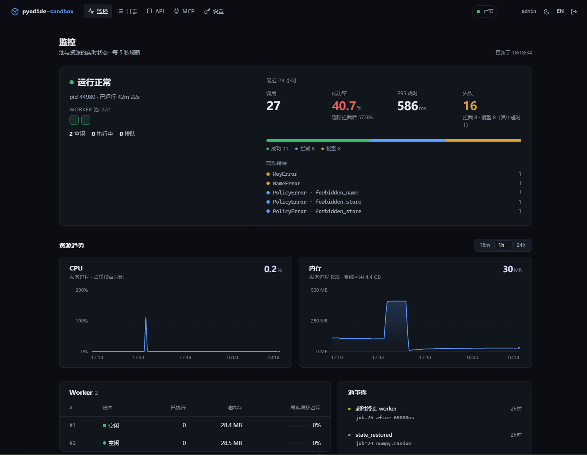

# pyodide-sandbox

[](https://github.com/dongfeng3692/pyodide-sandbox/actions/workflows/ci.yml)
[](LICENSE)
[](https://nodejs.org)

**English** · [中文](README.zh-CN.md)

> Not affiliated with the Pyodide project.

**Hardened Pyodide execution sandbox for AI agents** — run model-generated
Python in one Node process, safely: server-side, session-isolated,
zero-persistence. No container fleet, no image lifecycle, no runtime
dependencies besides Pyodide itself.



## Highlights

- **Five hardening layers** — WASM memory safety, bridge-module removal,
  NFKC-aware AST policy engine, safe-builtin replacement with a caged
  `__import__`, optional Node process-capability mode (`--permission`)
- **Model-self-correcting errors** — every failure carries
  `{type, code, line, symbol, hint}`; agents fix their code in one retry
  instead of guessing
- **Generated MCP docs that cannot drift** — the `execute_code` tool
  description and `initialize` instructions are rendered from the *active*
  policy and config, so what the agent reads is what the workers enforce
- **Five-page bilingual admin UI** — monitoring with failure classes
  (blocked ≠ outage), execution logs, API docs, MCP gateway, token and
  package management; zero external assets
- **Contract-frozen test suite** — 140+ end-to-end regression cases across
  7 policy profiles run in CI on every push (Linux + Windows, plus a Docker
  smoke test)

## What this is — read this first

It executes **small, one-shot Python computations** for AI agents — and
nothing else:

- **Not a normal Python environment.** It runs Pyodide (CPython compiled to
  WASM) behind a code-level policy: no `import`, no network, no filesystem
  paths, no subprocess, no threads, no shell. The only capabilities are a
  whitelist of safe builtins plus **pre-bound libraries** (`pd`, `np`, and
  whatever the operator injects).
- **Simple tasks only.** Parse an uploaded file, crunch numbers, reshape a
  table, return a JSON dict. It is not a notebook, not a REPL, not a general
  backend.
- **No context, ever.** Every call is fully independent — variables and files
  from a previous call are simply gone; send the data again with every call
  that needs it.
- **One-shot lifecycle.** Code goes in → a JSON `result` (+ `stdout`) comes
  out; workers are recycled regularly.

Persistent REPLs, arbitrary packages, or OS-level access are not offered —
by design.

> Status: v0.1. The layer stack is implemented and tested; the exact trust
> contract lives in [docs/threat-model.md](docs/threat-model.md). **For
> untrusted input, the process-capability layer (Node `--permission` + no
> egress) is mandatory** — see threat-model §4.6.

## Architecture

```
┌─ @pyodide-sandbox/server ─────────────────────────┐  HTTP: /exec /health
│  pool: worker threads, hard timeout, RSS recycle  │  (DB-managed token auth)
│  admin UI: dashboard / logs / tokens (SQLite)     │
├─ @pyodide-sandbox/core ───────────────────────────┤
│  runtime: boot → preload → harden → scratch wipe  │
│  policy: AST engine + presets (pure Python,       │  ← also usable
│          dual-use under CPython for pre-checks)   │    standalone
├─ pyodide (WASM) ──────────────────────────────────┘
```

Layers (full contract in [threat-model.md](docs/threat-model.md)):

1. zero-persistence sessions (fresh globals + scratch wiped before/after)
2. WASM memory safety (no syscalls, no native code)
3. **bridge removal** — `js`/`pyodide`/`micropip` deleted from `sys.modules`
   + `sys.meta_path` import denial (Pyodide alone is *not* a sandbox)
4. AST policy engine — banned syntax/names, dunder denial, attribute-STORE
   ban; NFKC-aware (full-width `ｅｖａｌ` caught)
5. builtins replacement (whitelist + caged `__import__` that only resolves
   already-loaded modules — it can never load new code)
6. process capability (recommended): `node --permission` + egress rule

## Quickstart

Requires **Node ≥ 23.4** (`node:sqlite` is used for tokens/logs/admin).

```bash
npm install
npm start                  # serves 127.0.0.1:8787
```

1. Open **http://127.0.0.1:8787/admin** — first visit initializes the admin
   account; or pin it via `SBX_ADMIN_USER`/`SBX_ADMIN_PASSWORD`.
2. In **Settings**, create an API token (shown exactly once).

```bash
curl -s -X POST 127.0.0.1:8787/exec -H 'x-sbx-token: <your-token>' \
  -H 'content-type: application/json' \
  -d '{"code": "result = {\"n\": 6*7}"}'
```

With a file + pandas:

```bash
B64=$(printf 'a,b\n1,2\n3,4\n' | base64 -w0)
curl -s -X POST 127.0.0.1:8787/exec -H 'x-sbx-token: <your-token>' \
  -H 'content-type: application/json' \
  -d "{\"code\": \"df = pd.read_csv(files[\\\"demo.csv\\\"])\nresult = {\\\"total\\\": int(df[\\\"a\\\"].sum())}\", \"files\": [{\"name\": \"demo.csv\", \"b64\": \"$B64\"}]}"
```

Or from Python — the client ships in this repository
(`packages/client-py`, install from source):

```python
from sbx_client import SbxClient
sbx = SbxClient("http://127.0.0.1:8787", token="<your-token>")
sbx.execute('df = pd.read_csv(files["demo.csv"])\nresult = {"rows": len(df)}',
            files={"demo.csv": b"a,b\n1,2\n"})
```

> First start downloads Pyodide packages into `pkg-cache/` (~8 MB); everything
> after that is offline.

## MCP

Enable the gateway in the admin UI (`/admin/mcp`), then point any
Streamable-HTTP MCP client at it with the same API token:

```json
{
  "mcpServers": {
    "pyodide-sandbox": {
      "type": "http",
      "url": "http://127.0.0.1:8787/mcp",
      "headers": { "Authorization": "Bearer <your-token>" }
    }
  }
}
```

The single `execute_code` tool takes `{code, files}` and returns structured
JSON; its description is generated from the active policy. Details:
[docs/api.md](docs/api.md#mcp-endpoint-post-mcp).

## Docker

```bash
docker build -t pyodide-sandbox .
docker run -d -p 127.0.0.1:8787:8787 -e SBX_ADMIN_PASSWORD=<secret> pyodide-sandbox
curl http://127.0.0.1:8787/health        # {"ok":true,...}
```

Offline-first image; the serving path runs under Node's permission model
(non-root, fs-restricted). Hardened baseline (read-only rootfs, `cap_drop:
ALL`, memory limit): `docker compose up -d --build`. Production guidance:
[docs/RUNBOOK.md](docs/RUNBOOK.md).

## Documentation

| Topic | Doc |
|---|---|
| HTTP + MCP API reference | [docs/api.md](docs/api.md) |
| Configuration, presets, env vars | [docs/configuration.md](docs/configuration.md) |
| Injectable dependencies (packages manifest) | [docs/packages.md](docs/packages.md) |
| Admin UI (monitoring, logs, tokens) | [docs/admin.md](docs/admin.md) |
| Trust contract & hardening layers | [docs/threat-model.md](docs/threat-model.md) |
| Deployment & operations | [docs/RUNBOOK.md](docs/RUNBOOK.md) |
| Contributing | [docs/CONTRIBUTING.md](docs/CONTRIBUTING.md) |
| Security reporting | [docs/SECURITY.md](docs/SECURITY.md) |
| Examples | [examples/custom-policy](examples/custom-policy) · [examples/fastapi-agent-tool](examples/fastapi-agent-tool) |

## Packages

| Package | What | Depends on |
|---|---|---|
| `@pyodide-sandbox/core` | policy engine + presets + hardened runtime | nothing (pyodide optional, injectable) |
| `@pyodide-sandbox/server` | worker pool + HTTP + admin UI + CLI | core, pyodide |
| `packages/client-py` | Python client (httpx) — source install, not on PyPI | httpx |

The policy engine (`src/policy/python/policy.py`) is also importable under
plain CPython for host-side pre-checks — the same code enforces inside and
outside the sandbox.

## License

Apache-2.0. Runtime dependency: [Pyodide](https://pyodide.org) (MPL-2.0 per
its npm metadata, used unmodified). The two vendored wheels in `wheels/` are
MIT; their licenses travel inside the wheel files. Security reporting:
[docs/SECURITY.md](docs/SECURITY.md).
