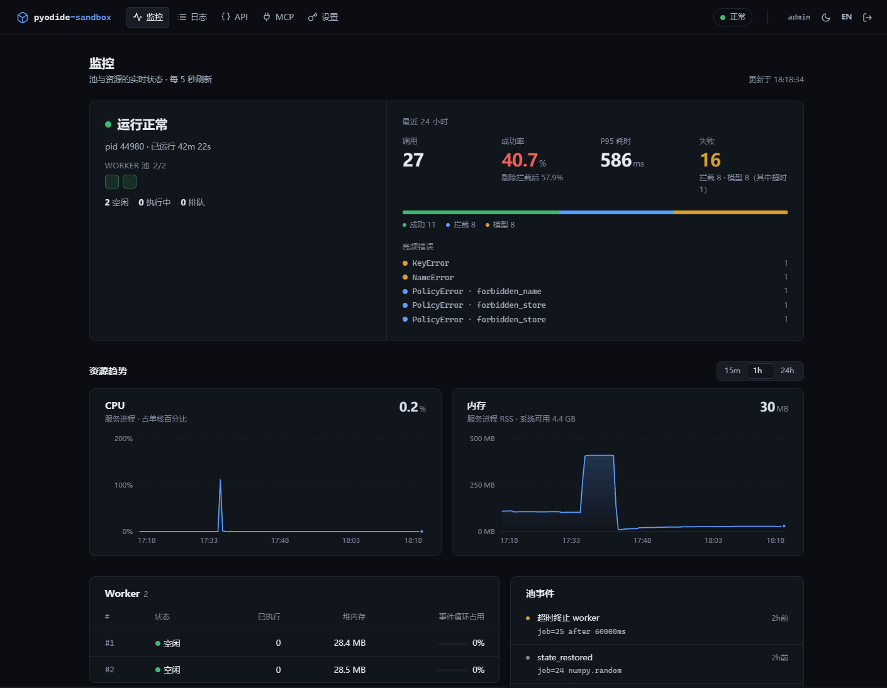

# pyodide-sandbox

[](https://github.com/dongfeng3692/pyodide-sandbox/actions/workflows/ci.yml)
[](LICENSE)
[](https://nodejs.org)

[English](README.md) · **中文**

> 与 Pyodide 官方项目无关。

**面向 AI agent 的加固 Pyodide 执行沙箱** —— 在单个 Node 进程里安全地运行
模型生成的 Python：服务端运行、会话隔离、零持久化。无需容器集群、无需镜像
运维，除 Pyodide 外零运行时依赖。



## 亮点

- **五层加固** —— WASM 内存安全、桥接模块移除、NFKC 感知的 AST 策略引擎、
  安全内建替换 + 被关进笼子的 `__import__`、可选的 Node 进程能力层
  （`--permission`）
- **模型可自纠的错误** —— 每个失败都带 `{type, code, line, symbol, hint}`，
  agent 一次重试就能改对，而不是反复猜
- **永不漂移的生成式 MCP 文档** —— `execute_code` 工具描述与 `initialize`
  instructions 由*生效中的*策略与配置渲染，agent 读到的就是 worker 执行的
- **五页双语管理端** —— 带失败分类的监控（拦截 ≠ 故障）、执行日志、API 文档、
  MCP 网关、令牌与依赖包管理；零外部资源
- **契约冻结测试套件** —— 140+ 端到端回归用例覆盖 7 个策略档位，每次 push
  在 CI 全量执行（Linux + Windows，外加 Docker 冒烟测试）

## 先读这个：它是什么

它为 AI agent 执行**一次性的简单 Python 计算**，仅此而已：

- **不是常规 Python 环境。** 运行的是 Pyodide（WASM 版 CPython），且套着
  代码级策略：不能 `import`、无网络、无文件系统路径、无子进程、无线程、
  无 shell。可用能力只有安全内建白名单 + **预绑定库**（`pd`、`np`，以及
  运维方注入的模块）。
- **只做简单任务。** 解析上传的文件、算个数、整理一张表、返回一个 JSON
  dict。它不是 notebook、不是 REPL、不是通用后端。
- **没有上下文。** 每次调用完全独立——上一次调用的变量和文件直接消失，
  哪个调用要用数据就随那个调用重新发。
- **一次性生命周期。** 代码进 → JSON `result`（+ `stdout`）出；worker 定期
  回收。

持久 REPL、任意包、操作系统级访问**不在本产品范围内**——这是刻意设计。

> 状态：v0.1。分层均已实现并有测试；完整信任契约见
> [docs/threat-model.md](docs/threat-model.md)。
> **跑不可信输入时，进程能力层（Node `--permission` + 禁出网）是必选项**
> ——见威胁模型 §4.6。

## 架构

```
┌─ @pyodide-sandbox/server ─────────────────────────┐  HTTP: /exec /health
│  pool: worker 线程池,硬超时,RSS 回收              │  (数据库令牌鉴权)
│  admin 管理端:监控 / 日志 / 令牌(SQLite)         │
├─ @pyodide-sandbox/core ───────────────────────────┤
│  runtime: 启动 → 预载 → 加固 → scratch 擦除       │
│  policy: AST 引擎 + 预设(纯 Python,亦可在         │  ← 也可独立使用
│          CPython 下做宿主侧预检)                  │
├─ pyodide (WASM) ──────────────────────────────────┘
```

分层（完整契约见 [threat-model.md](docs/threat-model.md)）：

1. 零持久化会话（每次全新 globals + 前后擦除 scratch）
2. WASM 内存安全（无系统调用、无原生代码）
3. **桥接移除** —— `js`/`pyodide`/`micropip` 从 `sys.modules` 删除 +
   `sys.meta_path` import 拒绝（光有 Pyodide *不是*沙箱）
4. AST 策略引擎 —— 禁语法/禁名、dunder 拒绝、属性 STORE 禁止；
   NFKC 感知（全角 `ｅｖａｌ` 也会被抓）
5. 内建替换（白名单 + 被关进笼子的 `__import__`，只解析已加载模块——
   永远无法加载新代码）
6. 进程能力（推荐）：`node --permission` + 出网规则

## 快速开始

需要 **Node ≥ 23.4**（令牌/日志/管理端使用 `node:sqlite`）。

```bash
npm install
npm start                  # 监听 127.0.0.1:8787
```

1. 打开 **http://127.0.0.1:8787/admin** —— 首次访问初始化管理员账号；
   也可用 `SBX_ADMIN_USER`/`SBX_ADMIN_PASSWORD` 预先钉住。
2. 在 **Settings** 里创建 API 令牌（明文只显示一次）。

```bash
curl -s -X POST 127.0.0.1:8787/exec -H 'x-sbx-token: <your-token>' \
  -H 'content-type: application/json' \
  -d '{"code": "result = {\"n\": 6*7}"}'
```

带文件 + pandas：

```bash
B64=$(printf 'a,b\n1,2\n3,4\n' | base64 -w0)
curl -s -X POST 127.0.0.1:8787/exec -H 'x-sbx-token: <your-token>' \
  -H 'content-type: application/json' \
  -d "{\"code\": \"df = pd.read_csv(files[\\\"demo.csv\\\"])\nresult = {\\\"total\\\": int(df[\\\"a\\\"].sum())}\", \"files\": [{\"name\": \"demo.csv\", \"b64\": \"$B64\"}]}"
```

Python 调用——客户端随本仓库提供（`packages/client-py`，源码安装）：

```python
from sbx_client import SbxClient
sbx = SbxClient("http://127.0.0.1:8787", token="<your-token>")
sbx.execute('df = pd.read_csv(files["demo.csv"])\nresult = {"rows": len(df)}',
            files={"demo.csv": b"a,b\n1,2\n"})
```

> 首次启动会下载 Pyodide 包到 `pkg-cache/`（约 8 MB）；之后全程离线。

## MCP

在管理端开启网关（`/admin/mcp`），然后让任意 Streamable-HTTP MCP 客户端
用同一 API 令牌接入：

```json
{
  "mcpServers": {
    "pyodide-sandbox": {
      "type": "http",
      "url": "http://127.0.0.1:8787/mcp",
      "headers": { "Authorization": "Bearer <your-token>" }
    }
  }
}
```

唯一的 `execute_code` 工具接收 `{code, files}` 并返回结构化 JSON；其描述
由生效策略生成。细节见 [docs/api.md](docs/api.md#mcp-endpoint-post-mcp)。

## Docker

```bash
docker build -t pyodide-sandbox .
docker run -d -p 127.0.0.1:8787:8787 -e SBX_ADMIN_PASSWORD=<secret> pyodide-sandbox
curl http://127.0.0.1:8787/health        # {"ok":true,...}
```

离线优先镜像；服务路径运行在 Node 权限模型下（非 root、文件系统受限）。
加固基线（只读根文件系统、`cap_drop: ALL`、内存上限）：
`docker compose up -d --build`。生产指引：[docs/RUNBOOK.md](docs/RUNBOOK.md)。

## 文档

| 主题 | 文档 |
|---|---|
| HTTP + MCP API 参考 | [docs/api.md](docs/api.md) |
| 配置、预设、环境变量 | [docs/configuration.md](docs/configuration.md) |
| 可注入依赖（依赖清单） | [docs/packages.md](docs/packages.md) |
| 管理端（监控/日志/令牌） | [docs/admin.md](docs/admin.md) |
| 信任契约与加固分层 | [docs/threat-model.md](docs/threat-model.md) |
| 部署与运维 | [docs/RUNBOOK.md](docs/RUNBOOK.md) |
| 参与贡献 | [docs/CONTRIBUTING.md](docs/CONTRIBUTING.md) |
| 安全报告 | [docs/SECURITY.md](docs/SECURITY.md) |
| 示例 | [examples/custom-policy](examples/custom-policy) · [examples/fastapi-agent-tool](examples/fastapi-agent-tool) |

## Packages

| 包 | 内容 | 依赖 |
|---|---|---|
| `@pyodide-sandbox/core` | 策略引擎 + 预设 + 加固运行时 | 无（pyodide 可选、可注入） |
| `@pyodide-sandbox/server` | worker 池 + HTTP + 管理端 + CLI | core、pyodide |
| `packages/client-py` | Python 客户端（httpx）——源码安装，不上架 PyPI | httpx |

策略引擎（`src/policy/python/policy.py`）也可在纯 CPython 下导入做宿主侧
预检——同一份代码在沙箱内外执行同一套约束。

## 路线图

- [ ] `strict-data` pandas 门面（read_csv/read_excel 身份绑定、严格解码、
      单元格预检）
- [ ] 阶段状态：具名 pickle 工件经调用方往返（宿主中介，不驻留沙箱）
- [ ] matplotlib 产物通道（AGG 后端钩子、大小封顶，走
      `result.artifacts`——不从 stdout 走私）
- [ ] Prometheus `/metrics`
- [ ] 浏览器构建：iframe（`allow-scripts`、不透明 origin）承载同一 core

## License

Apache-2.0。运行时依赖：[Pyodide](https://pyodide.org)（按其 npm 元数据为
MPL-2.0，未修改地使用）。`wheels/` 内两个 vendored wheel 为 MIT，许可证随
wheel 文件内部携带。安全报告：[docs/SECURITY.md](docs/SECURITY.md)。
